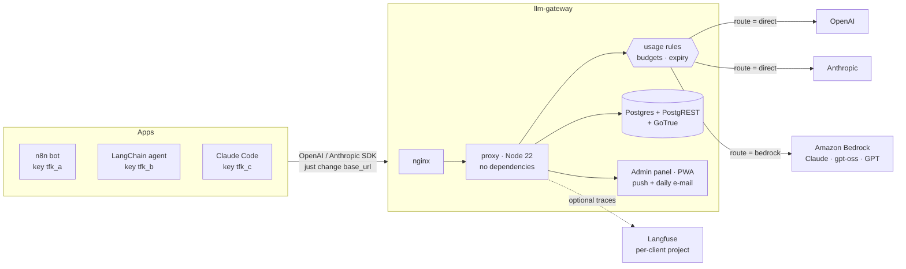

# llm-gateway

**A self-hosted gateway for OpenAI, Anthropic and Amazon Bedrock.** Give every app, bot or teammate its own key,
cap what they can spend, cut them off by rule, and see exactly who used which model, when, and for how much.
Your real provider keys never leave the gateway.

> 🇨🇱 Built and used in production by a small Chilean software shop to run the LLM traffic of its clients' WhatsApp
> bots, internal agents and coding assistants. Spanish summary at the [bottom](#resumen-en-español).



## Why

Handing a raw `sk-…` key to every bot and contractor means no per-client cost, no kill switch, and a rotation
nightmare when one leaks. A gateway fixes that, but most options are either SaaS (your prompts and keys go through
someone else) or heavy. This one is **one small Node process + a Postgres you already know how to run**: about
5 000 lines, **zero npm dependencies** in the proxy (only `node:` built-ins), and a panel that is plain HTML/JS.

## What it does

| | |
|---|---|
| **Per-client keys** | `tfk_…` keys, hashed (SHA-256) at rest, optional expiry date, one description per key. Clients are grouped into *companies* (multi-tenant, with RLS in Postgres). |
| **Drop-in proxy** | `/openai/v1/*` and `/anthropic/v1/*` — same request/response shapes, SSE streaming passes through unbuffered; tokens are counted on the fly (including cache read/write, audio, Responses API). |
| **Real cost tracking** | Price table in SQL (USD per 1M tokens, edit it from the panel), cost per call, per client, per day. Optional sync of the *actual* cost from the providers' admin keys to reconcile. |
| **Budgets & rules** | Monthly USD budget per client (`429 budget_exceeded`). Usage rules on `tokens`, `tokens_out`, `costo_usd` or `llamadas`, over a rolling or calendar window, filtered by client/provider/model, restricted to a weekly schedule, with a warn threshold and a hard cut (`403 usage_rule`). Rules refresh every 5 s and are also tallied in memory, so a cut is immediate. |
| **Bedrock routing** | Per company or per client, `route = direct \| bedrock`. The app keeps speaking Anthropic Messages (or OpenAI Chat) format; the gateway translates model names, signs with SigV4 and converts Bedrock's binary event stream back to SSE. See [docs/bedrock.md](docs/bedrock.md). |
| **Prepaid balance pace** | Tracks credit top-ups with expiry and tells you if you are on pace to burn it, lose it or run out. |
| **Panel** | Installable PWA: consumption, per-client keys, rules with live usage bars, balances, push notifications and a daily e-mail report. Log-in via GoTrue (Supabase auth). |
| **Langfuse (optional)** | Per-client trace export with prompt, session and origin. |
| **Safe by default** | Provider keys encrypted with AES-256-GCM (`GATEWAY_ENC_KEY`), never returned by the API; the gateway key is stripped before forwarding; admin API needs a master key or an admin key. |
| **Fail-soft** | If the database is briefly unreachable, loaded rules keep applying and consumption rows are queued and flushed later. |

## Quick start

Requirements: Docker + Docker Compose, Node ≥ 22 (only to generate the `.env`).

```bash
# 1. secrets (writes .env, mode 600, prints nothing)
node tools/generar-env.mjs http://localhost:8740

# 2. database, schema, then everything else
docker compose up -d db && bash tools/migrar.sh && docker compose up -d

# 3. check
curl -s localhost:8740/health        # {"ok":true,...}
```

Then, with the master key from `.env`:

```bash
export GW=http://localhost:8740 MASTER=$(grep ^GATEWAY_MASTER_KEY .env | cut -d= -f2)
H=(-H "authorization: Bearer $MASTER" -H "content-type: application/json")

# store the real provider key (encrypted) for company "acme" (seeded by the first migration)
curl -s -X PUT $GW/admin/credenciales "${H[@]}" \
  -d '{"empresa_id":"acme","proveedor":"openai","tipo":"api","valor":"sk-..."}'

# create a client with a US$ 30/month budget -> returns its tfk_ key ONCE
curl -s -X POST $GW/admin/clientes "${H[@]}" \
  -d '{"empresa_id":"acme","nombre":"support-bot","presupuesto_usd_mensual":30}'
```

Use it like the provider, changing only the base URL and key:

```python
from openai import OpenAI
client = OpenAI(base_url="http://localhost:8740/openai/v1", api_key="tfk_...")
client.chat.completions.create(model="gpt-4.1-mini", messages=[{"role": "user", "content": "hi"}])
```

```bash
# Anthropic works the same way
curl http://localhost:8740/anthropic/v1/messages -H "x-api-key: tfk_..." -H "anthropic-version: 2023-06-01" \
  -H "content-type: application/json" -d '{"model":"claude-haiku-4-5","max_tokens":64,"messages":[{"role":"user","content":"hi"}]}'
```

Panel: create a login with `POST /admin/usuarios {"email","password"}` and open `http://localhost:8740/panel/`.

### Example: cut a client off outside office hours

```bash
curl -s -X POST $GW/admin/reglas "${H[@]}" -d '{
  "empresa_id":"acme","nombre":"no night traffic","metrica":"llamadas","limite":0,
  "ventana_tipo":"movil","ventana_minutos":60,"accion":"cortar",
  "horario_dias":[0,1,2,3,4,5,6],"horario_desde":"23:00","horario_hasta":"07:00"}'
```

`limite: 0` fires as soon as the rule is inside its schedule, so this blocks that window entirely.

## Layout

```
proxy/          Node proxy + admin API (server.mjs, lib/*.mjs) and its tests (node:test)
panel/          admin panel: static HTML + vanilla JS, PWA (service worker, push)
db/migrations/  21 idempotent SQL migrations (schema, RLS, views, price tables)
gw/nginx.conf   entry point: /auth, /rest, and everything else → proxy (no buffering)
tools/          env generator, migration runner, usage/cost inventory scripts
cliente/        optional local fail-over for Claude Code in subscription mode
docs/           bedrock.md (API contract) · suscripcion.md (rules, subscription mode)
```

## Tests

```bash
npm test        # 70 tests, ~2 s, node built-in runner, no install needed
```

They cover streaming token accounting (OpenAI chat/Responses, Anthropic), cost, usage rules (windows, schedules,
cuts), key expiry, Bedrock SigV4 + event-stream translation, push, and the local fail-over.

## Known limitations

- **Spanish source.** Identifiers, comments, panel and e-mail text are in Spanish (it was built for a Chilean team).
  Translating the panel strings is a contained job (`panel/*.js`, `proxy/lib/reporte.mjs`).
- **Time zone is fixed to `America/Santiago`** for calendar windows and day buckets (see `ZONA` in
  `proxy/lib/reglas-logica.mjs` and the `at time zone` in the SQL views).
- **Subscription pass-through mode** (`/suscripcion/anthropic`, [docs/suscripcion.md](docs/suscripcion.md)) forwards a
  coding-assistant OAuth login through the gateway for accounting and rules. It is **off by default**
  (`SUSCRIPCION_HABILITADA=false`); check your provider's terms before turning it on.
- The panel loads Chart.js from jsDelivr and `supabase-js` from esm.sh (CDN); vendor them if you need it offline.
- The seed price table is a snapshot — prices change; edit `precios` (or add a migration) to keep it current.
- No horizontal scaling story yet: one proxy instance, rules and key caches are in-process.

## Security notes

Never commit `.env`. Rotate `GATEWAY_MASTER_KEY` if it leaks (restart the proxy). Put the gateway behind TLS; if you
use it for subscription mode, prefer a private network over a CDN/tunnel that terminates TLS (see
[docs/suscripcion.md](docs/suscripcion.md)).

## License

[MIT](LICENSE)

---

## Resumen en español

**llm-gateway** es un proxy autoalojado para OpenAI, Anthropic y Amazon Bedrock. Cada app o persona recibe su propia
llave (`tfk_…`), con presupuesto mensual, vencimiento y reglas de uso (por ventana de tiempo, horario, modelo o
cliente) que pueden avisar o cortar al instante. Las llaves reales de los proveedores quedan cifradas dentro del
gateway. Registra tokens y costo por llamada, tiene un panel web instalable (PWA) con avisos push y reporte diario por
correo, enruta a Bedrock sin cambiar el código de la app y exporta trazas a Langfuse. Son ~5 000 líneas de Node sin
dependencias más un Postgres. Arranque: `node tools/generar-env.mjs http://localhost:8740`, luego
`docker compose up -d db && bash tools/migrar.sh && docker compose up -d`.
